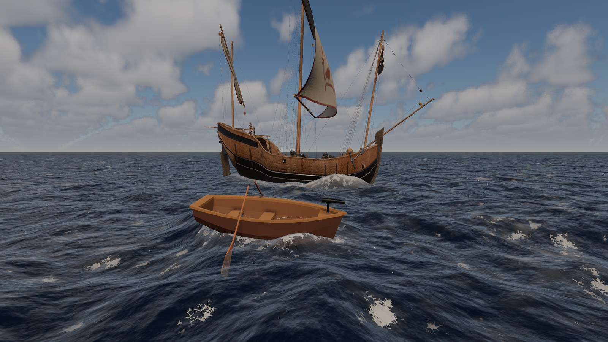
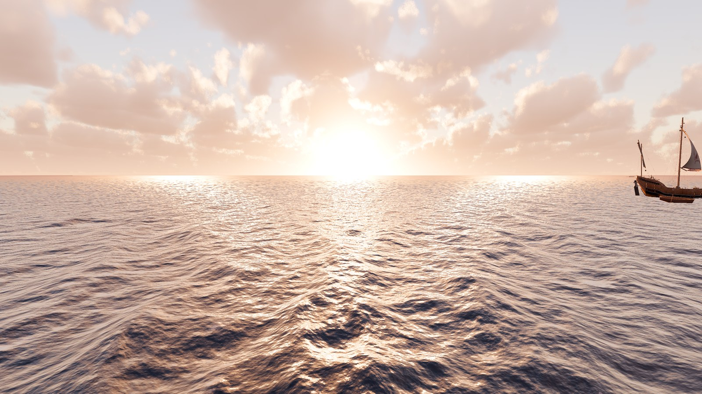
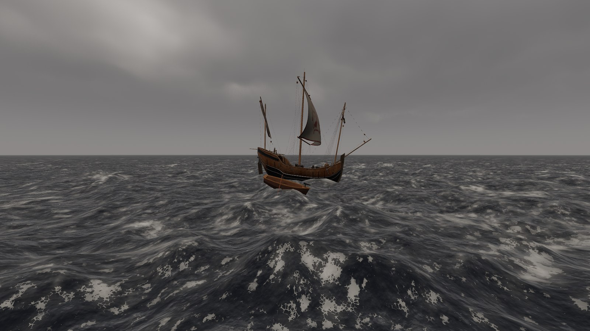
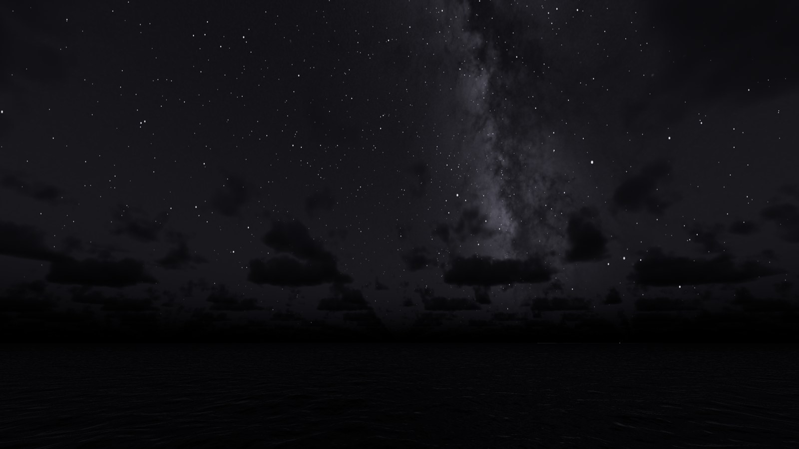

# Godot-RealisticEnvironments

**English** · [简体中文](README.zh-CN.md)

A physically based open ocean for Godot 4.8. It has FFT waves out to a curved
horizon, a physical sky with an atmosphere, volumetric clouds and the night
sky, eye-like exposure, and drivable boats.

> **Work in progress.** Boats float and leave wakes; foam around hulls and
> cutting the water out of open boats are still being built.



| | |
| --- | --- |
|  |  |
|  | |

## How it works

The project is a set of Godot addons. Each one does one job and works on its
own. They connect through small contracts instead of each other's types.

| Addon | What it does |
| --- | --- |
| [`core`](addons/core/README.md) | The shared contracts (`WaterSurface`, `WindSource`) and GPU helpers. |
| [`wind_system`](addons/wind_system/README.md) | One wind with gusts. The waves and the clouds follow it. |
| [`ocean_system`](addons/ocean_system/README.md) | FFT waves computed on the GPU and a level-of-detail mesh to the horizon. Also water shading, foam, reflections, boat wakes and water-height queries. |
| [`sky_system`](addons/sky_system/README.md) | Astronomical sun and moon, a physical atmosphere, volumetric clouds, stars and planets. It lights the scene and meters that light. |
| [`exposure_system`](addons/exposure_system/README.md) | Exposes the camera for that light, adapting like an eye. |
| [`buoyancy_system`](addons/buoyancy_system/README.md) | Floats rigid bodies: they rest at a set draft, ride the waves and drift downwind. |
| [`hitbox_damage_system`](addons/hitbox_damage_system/README.md) | Projectile hitboxes and health per group (e.g. hull, mast). |
| [`ocean_environment`](addons/ocean_environment/README.md) | Wind, sky, ocean and exposure in one ready-wired scene. |
| [`boat_template`](addons/boat_template/README.md) | A ready-wired boat: buoyancy, driving, health and camera anchors. |

```
WindSystem --- wind ---> OceanSystem <--- sky source --- SkySystem --- light ---> ExposureController
    |                     |      ^                           ^
    +---------------------|------|--- wind (cloud drift) ----+
                registers |
                          v
      WaterSurface (core): async height queries
```

- The ocean and the sky render with compute shaders on the GPU each frame:
  wave spectra and FFTs, the atmosphere's lookup textures, and the clouds.
- Physics code never touches the ocean directly. It submits points to the
  world's `WaterSurface` every physics tick and reads the answer a few frames
  later, extrapolated to the present.
- Most units are physical: wind in m/s, light in lux, water optics per metre.
  The look comes from the physics, not from artistic tints.

## Requirements

- Godot **4.8** with the **Forward+** renderer. The ocean, the atmosphere and
  the clouds need compute shaders, so the Compatibility renderer and headless
  runs have no water or sky. The Mobile renderer is untested.
- A desktop GPU. The project was developed on Windows with an RTX 4070 Ti;
  other platforms are untested.
- Physical light units off (the default).

## How to use

**Try it.** Open the folder in Godot 4.8 and run the project (the demo,
`demo/main.tscn`), or open one of the [examples](examples/README.md):

| Example | Shows |
| --- | --- |
| `examples/ocean_only.tscn` | The drop-in environment and a fly camera. |
| `examples/floating_objects.tscn` | Crates and barrels riding the waves. |
| `examples/boat.tscn` | A drivable boat (W A S D) built on the boat template. |

**Use it in your project.**

1. Copy `addons/core` and the addons you want into your project's `addons/`
   folder. Each addon needs the ones listed below.
2. Enable them in **Project Settings > Plugins**. The plugins add what the
   project needs (the sky's global shader uniforms and debanding, the boat's
   input actions), never change existing settings, and print what they added.
3. Instance `addons/ocean_environment/ocean_environment.tscn`, add a
   `Camera3D` whose far plane reaches past the horizon (the demo uses 60 km),
   and run.
4. For a boat, inherit `addons/boat_template/boat.tscn`.

| Addon | Needs |
| --- | --- |
| `core`, `wind_system`, `exposure_system`, `hitbox_damage_system` | Nothing |
| `ocean_system`, `sky_system`, `buoyancy_system` | `core` |
| `ocean_environment` | `core`, `wind_system`, `sky_system`, `ocean_system`, `exposure_system` |
| `boat_template` | `core`, `buoyancy_system`, `hitbox_damage_system` |

Every setting has an inspector tooltip, and every class has a page in the
editor's help (F1, then search for e.g. `OceanSystem`). Misconfigured nodes
show warnings in the Scene dock.

## The demo

`demo/main.tscn` is the development sandbox. You drive a rowboat with a bow
swivel gun. There is a caravel you can shoot, a buoy, a compass HUD
and a hidden debug panel for most ocean, sky and wind settings. The weapons
(`projectile_launcher_system`, `floating_boat_template`) are demo gameplay and
not part of the open-source addons. `demo/ocean_optics_debug.tscn` is a
lighter scene for tuning the water's shading.

| Input | Action |
| --- | --- |
| W / S | Throttle forward / reverse |
| A / D | Turn left / right |
| Space | Fire at the aim marker |
| Right mouse (hold) | Mouse look |
| C | Camera: third person → first person → free look |
| Free look: W A S D, R / F, Shift, wheel | Fly, up / down, boost, fly speed |
| H or \` | Debug panel |
| F | Fullscreen (also "down" in free look) |
| Esc | Leave fullscreen, release the mouse |

## Repository layout

```
addons/      The addons, each with its own README
examples/    Example scenes that use only the open-source addons
demo/        The demo scenes, ships and third-party models
systems/     Demo support code: camera rig, debug panel, compass HUD
tools/       Development scripts (lint, star catalog, Milky Way, example hull)
docs/        Design records and images
```

`CONTRIBUTING.md` explains how to report problems and send changes,
`AGENTS.md` holds the working rules for the code, and `CHANGELOG.md` lists the
changes.

## License and credits

- **Code** (addons, examples, demo scripts, tools): MIT, `LICENSE`
  (© 2026 itzMeerkat). The wave simulation started from
  [2Retr0/GodotOceanWaves](https://github.com/2Retr0/GodotOceanWaves) by Ethan
  Truong, MIT, `LICENSE_original` (also in `addons/ocean_system/LICENSE`).
  `README_original.md` is the upstream write-up of the spectrum and FFT math.
- **Demo models** (`demo/assets/`): CC BY 4.0, by Ginny Sutton ("Caravel
  Ship") and Muyaya Concept ("Stylized Low Poly Rowboat with Paddles", "Red
  Marine Navigation Buoy"). Sources and details are in
  `demo/assets/README.md`. The addons and examples do not use them.
- **Stars**: the Bright Star Catalogue, 5th Revised Ed. (Hoffleit & Warren
  1991; CDS catalogue V/50), baked by `tools/bake_star_catalog.py`.
- **Milky Way**: NASA/Goddard Space Flight Center Scientific Visualization
  Studio, Deep Star Maps 2020 (https://svs.gsfc.nasa.gov/4851), public domain;
  Gaia DR2: ESA/Gaia/DPAC. Baked by `tools/bake_milky_way.py`.
- **Example boat hull**: generated by `tools/make_example_hull.py` (MIT, like
  the code).
